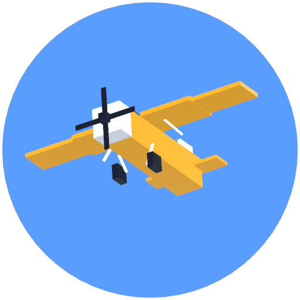

# Toy Plane Sim

A cartoon low-poly multiplayer plane game made with Godot 4.7. Fly with friends over the internet using a room code, with no server and no accounts.

## Download and play

Get the latest **Mac** or **Windows** zip from [Releases](https://github.com/SumantxD/toy-plane-sim/releases/latest). Unzip it and open `HOW_TO_PLAY.txt`.

- **Mac:** the first time, right-click `Toy Plane Sim.app` > Open > Open (the app isn't from the App Store).
- **Windows:** if SmartScreen appears, click More info > Run anyway.
- **Both:** when the firewall asks, click **Allow**, or online play can't connect.

## Modes

- **Free Flight:** solo or group practice. Pop the balloons.
- **Co-op Escort:** protect 3 bombers through 8 waves of raiders.
- **Team Dogfight:** Blue vs Red with shared team lives. Revive teammates by flying through their beacon.
- **Team Battle vs AI:** you and AI wingmen against an AI squadron with personalities.
- **Capture the Flag:** steal the enemy flag and bring it home. First to 3 captures, 8-minute timer.
- **Base Assault:** strafe the enemy HQ while bomber raids fly for both sides. Repair yours with supplies.

Supplies: fly through a crate and carry it home for +1 team supply. Supplies buy AA guns, SAM sites and radar (keys 3/4/5) and HQ repairs (6). AI teammates take jobs (attack, defend, escort, hunt) in every mode.

Pick from 4 planes (Toy Cub, Speedster, Heavy Twin, Jet Fighter). Damage is per part: a hit wing pulls the plane to that side, a hit engine sputters, a hit tail makes turning sluggish.

## Playing together

The host clicks **Host online** and shares the 5-letter room code. Friends type it in and click **Join**. Players connect directly with WebRTC. The handshake goes through free public MQTT brokers, and NAT traversal uses free public STUN servers. If a pair of very strict networks can't connect, see the Tailscale tip in How to play.

## Building

1. Install Godot 4.7.2 and its export templates.
2. Run `./release.sh`. It writes `../builds/ToyPlaneSim-vX-{mac,windows}.zip`.
3. To run a headless bot match: `./test.sh 0 2 60 4` (escort, 2 bots, 60 s, 4x speed).

See `NOTES.md` for the architecture and `LEVEL.md` for the map layout.

## Credits

Made with Claude Code and the Godot Engine. The models, sounds and font are from Kenney (CC0). Networking uses webrtc-native and godot-mqtt. Full notices are in `THIRD_PARTY_LICENSES.txt`.
